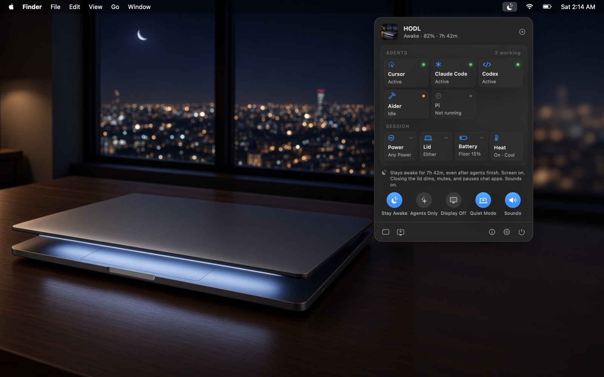
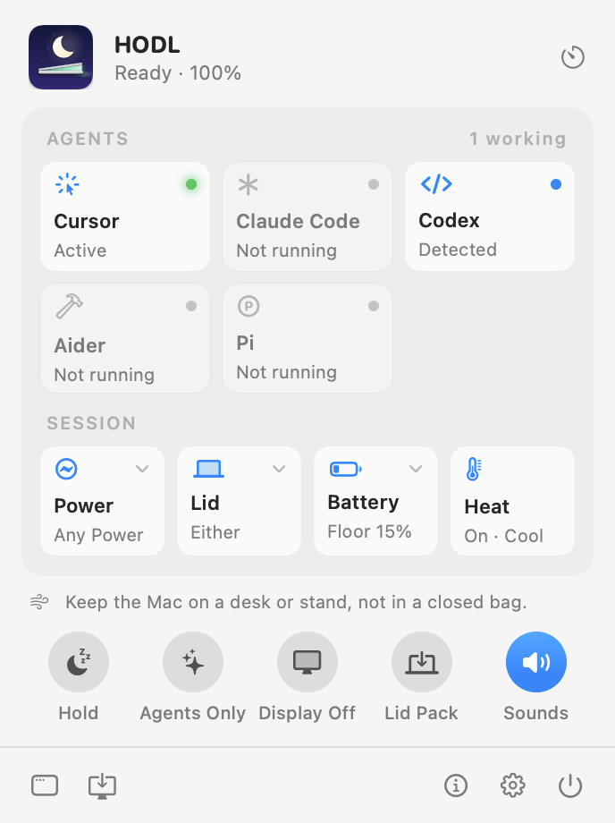
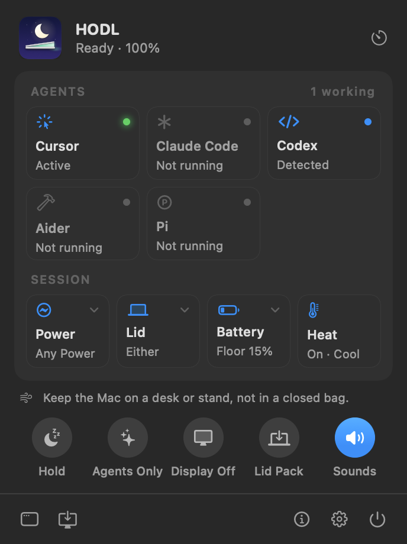

# HODL

**Hold the Door Lid.** HODL holds your Mac awake so your AI agents keep running overnight, with the lid open or closed, on AC or battery. From 10 PM it turns on by itself the moment an agent starts working, so you don’t have to remember. It lets the Mac sleep again when your agents finish, the battery runs low, or the Mac gets hot, and it always tells you why.

<p align="center">
  
</p>

<p align="center">
  
  
</p>

## Download

**[Download HODL 1.0.7](https://github.com/deepujain/hodl/releases/download/v1.0.7/HODL.zip)** (universal, 2.9 MB) · [release notes](https://github.com/deepujain/hodl/releases/tag/v1.0.7) · [website](https://1xaispark.com/apps/hodl.html)

Requires macOS 14 Sonoma or later, on Apple silicon or Intel. Unzip and move HODL to Applications. The first time you open it, macOS blocks it with “Apple cannot check it for malicious software,” because the build isn’t notarized by Apple yet. Click **OK**, then open **System Settings › Privacy & Security**, scroll down to **Security**, click **Open Anyway** next to HODL, and enter your password. You only need to do this once. Prefer Terminal? `xattr -dr com.apple.quarantine /Applications/HODL.app` does the same thing.

## Nothing to remember

From 10 PM, HODL turns **Stay Awake** on by itself as soon as an agent is working. It keeps the Mac awake until your agents finish, and never past 7 AM. If your agents go quiet and start again before morning, it turns on again. If you turn it off yourself, it stays off for the rest of the night. Change the start time (7 PM to 11 PM) or turn this off in **Settings › Awake › At night**.

## Which switches to turn on

| I want… | 🌙 Stay Awake | ✨ Agents Only | 🖥️ Display Off | 🔕 Quiet Mode |
|---|:---:|:---:|:---:|:---:|
| ⭐ **Mac awake overnight while agents run, lid open or closed** (default) | ✅ On | ✅ On | Off | Off |
| **Same, but dim, muted, and chat apps paused when the lid is closed** | ✅ On | ✅ On | Doesn’t matter | ✅ On |
| **Mac awake for 8 hours, agents or not** | ✅ On | Off | Doesn’t matter | Doesn’t matter |
| **Normal Mac, sleeps as usual** | Off | Doesn’t matter | Doesn’t matter | Doesn’t matter |

With the default switches you don’t need to touch anything at night: Stay Awake turns on by itself from 10 PM. Before then, turn it on from the panel.

On is blue in the panel, Off is grey. **Stay Awake** is the main switch: nothing else keeps the Mac awake on its own. **Agents Only** lets the Mac sleep about 10 minutes after your agents finish, instead of after 8 hours. **Display Off** only turns the screen off. **Quiet Mode** only acts when you close the lid: it dims the screen and keyboard light, mutes sound, and pauses chat apps, and puts them back when you open it.

Whatever you choose, the Mac still sleeps at 15% battery or if it gets too hot. On battery, macOS sleeps when you close the lid unless you click **Allow** in the panel once and enter your password (or turn on the closed-lid helper in **Settings › Lid & Display**); plugged in, nothing else is needed.

## Build

```bash
./build.sh            # universal release build → build/HODL.app
./build.sh debug      # this Mac only, faster
./package.sh          # build/HODL.zip for sharing
open build/HODL.app
```

The build uses SwiftPM, `lipo` for a universal binary, the icon rendered from `Resources/IconPhoto.jpg` with `--render-icon` + `iconutil`, and an ad hoc signature. HODL is a menu bar app (`LSUIElement`) with no Dock icon.

## How it keeps the Mac awake

- **IOKit power assertions** (`PreventUserIdleSystemSleep` and `PreventSystemSleep`) are the main mechanism. They belong to the HODL process, so macOS drops them the moment HODL quits or crashes. If macOS refuses them, HODL falls back to `caffeinate -i -s -w <pid>`, which also exits with HODL.
- **Lid closed on AC** works with assertions alone.
- **Lid closed on battery** is different: macOS sleeps on lid close regardless of assertions. The only switch is `pmset disablesleep`, which needs root. HODL offers it as an opt-in **closed-lid helper**: a one-time sudoers rule (`/etc/sudoers.d/hodl`) that allows exactly `pmset -a disablesleep 0|1` and `pmset -a lowpowermode 0|1`. HODL turns lid sleep off only while it is keeping the Mac awake, and always turns it back on.

## Safety

- **Recovery journal.** Every change outside HODL’s own process (lid sleep, Low Power Mode, muted audio, display and keyboard brightness, paused apps) is written to `~/Library/Application Support/HODL/recovery.json` *before* it is made, and undone from that file when HODL turns off, on quit, on `SIGTERM`/`SIGINT`/`SIGHUP`, and on the next launch.
- **launchd backstop.** While the journal contains anything, a per-user LaunchAgent runs `HODL --backstop` every 20 seconds. If HODL has died, it restores everything and removes itself.
- **Safety stops** let the Mac sleep and say why: battery floor (default 15%), battery unreadable on battery, critical heat or serious heat for 10 minutes, unplugged in AC Only mode, session timer, agents finished.
- **Hard maximum** of 12 hours by default. Adding time never schedules more than the maximum ahead of now. A no-limit session is opt-in and still obeys every safety stop.
- **Your Low Power Mode wins.** HODL only turns Low Power Mode on, and only when it was off. If you turn it off while HODL is on, HODL forgets its change and won’t turn it back on until the next night.
- **Clean uninstall.** Settings › General › Uninstall removes hooks (restoring backups), the command-line tools, the closed-lid helper, the login item, and App Nap settings, then moves HODL to the Trash. It refuses while HODL is keeping the Mac awake or anything is still waiting to be put back.

## Features

**Stay Awake.** Overnight (8 hours by default), timed presets (4, 8, 12 hours, until 7 AM), until agents finish, or no limit. You can add time, pause for 30 minutes or an hour, and turn it off. Toggle with **⌥⌘L** from anywhere.

**Night schedule.** From 10 PM (you can pick 7 PM to 11 PM), Stay Awake turns on by itself when an agent starts working, in Agents Only mode until 7 AM. It doesn’t turn on again that night after you turn it off or a safety stop ends it. On by default.

**Stay awake while an app runs.** Add apps in Settings › Awake. When one opens, HODL keeps the Mac awake until it quits, up to the hard maximum. Turn it off by hand and HODL leaves that app alone until it next opens.

**Power modes.** *Any Power* keeps the Mac awake on AC or battery and turns on Low Power Mode at a soft floor (40%) before the hard stop. *AC Only* keeps it awake only while plugged in. *Battery* keeps it awake down to the floor with no Low Power step. Assertions are recreated whenever the power source changes, so a plug or unplug with the lid closed doesn’t slip through.

**Lid policy.** Stay awake with the lid open, closed, or either.

**Agents.** HODL watches Cursor, Claude Code, Codex, Aider, Pi, OpenCode, Gemini CLI, Copilot CLI, Windsurf, and Cline. Each shows as Active, Idle, Detected, or Not running.
- **Hooks first.** One click (or `hodl install-hooks`) adds Working/Idle hooks to Claude Code, Codex, Cursor, and OpenCode, so HODL tracks each session separately and knows exactly when it’s working. Existing hooks are kept; Codex’s existing `notify` command is chained, not replaced. Every edited file is backed up as `.hodl-backup`.
- **Processes as a fallback.** Without hooks, HODL matches executable paths and bundle IDs and estimates work from CPU use across each agent’s process tree.
- **Agents Only.** With Agents Only on, HODL keeps the Mac awake only while an agent is working, and lets it sleep after a configurable idle timeout (10 minutes by default).
- **Privacy.** HODL never reads code, prompts, or terminal output. Hooks send only the agent name, its state, and a session ID; for interpreters, HODL reads only the script path.

**Quiet Mode.** When you close the lid while HODL is on: dim the display and keyboard backlight, mute sound, pause Slack, Discord, and WhatsApp (`SIGSTOP`), and optionally pause every other Dock app, turn on Low Power Mode, and lock the screen. Agents, terminals, meeting apps (Zoom, Teams, Webex, FaceTime, OBS, Loom), browsers, editors, and Apple’s own apps are never paused. Everything resumes when the lid opens or HODL turns off.

**Display.** Turn the display off when HODL turns on, turn it off now, turn it off N seconds after agents finish, or keep it on. Separately, *Prevent the screen saver and screen lock* declares user activity every 30 seconds while HODL is on (like `caffeinate -u`); leave it off and macOS locks as usual while agents keep working.

**Session window.** Countdown, add time and pause, agent sessions, live `pmset -g assertions`, and the history of when the Mac stayed awake, when it was allowed to sleep, and every change HODL made.

**Also:** notifications when HODL turns on and off, safety stops, agents finishing, and 10 minutes before the end; distinct menu bar icons for awake, standing by, off, and warning; open at login; optional App Nap opt-out for agent apps; a persistent warning if a restore ever fails.

## Command line

Settings › Agents installs `hodl`, `hodl-run`, and `hodl-hook` to `~/.local/bin`.

```bash
hodl hold                        # stay awake overnight
hodl hold --hours 4
hodl hold --until agents-idle    # sleep once every agent is idle
hodl hold --until 07:00
hodl extend 1                    # add an hour
hodl pause 30 && hodl resume
hodl release                     # turn off; the Mac sleeps as usual
hodl status                      # JSON

hodl-run -- ./long-job.sh        # stay awake while it runs, with heartbeats
```

URL scheme: `hodl://hold?hours=8`, `hodl://release`, `hodl://toggle`, `hodl://extend?hours=1`, `hodl://pause?minutes=30`, `hodl://status`.

HTTP API on `127.0.0.1:8742` (loopback only): `GET /status`; `POST /hold`, `/release`, `/toggle`, `/extend`, `/pause`, `/resume`, `/heartbeat?id=&ttl=`, `/lease-end?id=`, `/hook?agent=&state=&session=`. Requests that change anything need an `X-HODL` header, so web pages can’t drive it.

## Layout

```text
Sources/HODL/App      Entry point, windows, app icon
Sources/HODL/Model    Preferences, policies, harness catalog
Sources/HODL/Engine   Stay-awake engine, commands, local HTTP API
Sources/HODL/System   Assertions, power, recovery journal, backstop, quiet mode, hotkey, ledger
Sources/HODL/Agents   Process scanner, agent monitor, hook installer, App Nap
Sources/HODL/UI       Menu panel, session window, Settings, About
Scripts/              hodl, hodl-run, hodl-hook (bundled into the app)
Resources/            Info.plist, privacy manifest, icon photo
docs/photos/          Photos behind the website images (HODL --marketing <folder>)
```

## Not yet

Schedules and triggers, Shortcuts and AppleScript, hotspot failover, a tmux “continue” nudge, Always On over SSH, and a Homebrew cask. Builds are ad hoc signed; notarization needs a Developer ID certificate, so the first launch needs **Open Anyway** in System Settings › Privacy & Security.

Made by [1xAI](https://1xaispark.com/apps/hodl.html).

## License

MIT
